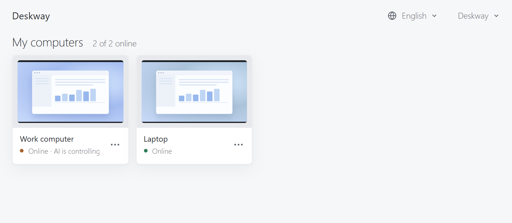
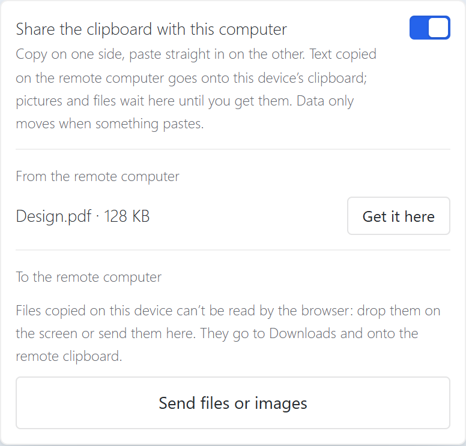

<p align="center"></p>

<h1 align="center">Deskway</h1>

<p align="center"><b>Control your computers from anywhere, and let your AI agent use them too.</b></p>

<p align="center"><b>English</b> · <a href="README.zh-Hans.md">简体中文</a> · <a href="README.zh-Hant.md">繁體中文</a></p>

Deskway is a remote desktop that you host yourself. Open your Windows PC or Mac from the browser
on a phone, tablet or another computer, and let AI agents work on the
computers you approve, including Linux servers. The server, the accounts and the relay all run
on a machine you control.

<p align="center"></p>

## What Deskway does

### Your desktop in any browser

There is nothing to install on the device in your hand: open your server's address and sign in.
Supported browsers can also install Deskway as an app on the desktop or home screen. On a phone,
touch the screen directly or switch to trackpad mode, and type with your own keyboard, input
method or dictation. If the computer has several displays, switch between them from the
toolbar.

Deskway Host stays in the Windows system tray or the Mac menu bar, so an approved device can
connect whenever the computer is on, with nobody sitting at it. On Windows that includes the
lock screen and the sign-in screen.



Turn on clipboard sharing and text copied on one side pastes on the other. Pictures and files
copied on the remote computer wait in the clipboard panel until you fetch them, and files you
send from your own device land in the remote computer's Downloads folder and on its clipboard.

<br clear="right">

### Remote control for AI agents

Deskway speaks the Model Context Protocol natively. Add `deskway mcp` to your AI client and it
can see the screen, use the mouse and keyboard, run commands, move files and work in apps on your
computers, so you can hand it tasks like these:

> Copy Design.pdf from the office workstation to the Downloads folder on my MacBook.

> Open the image app on the office workstation and generate a blue mountain landscape.

> Every morning at 9, tidy up yesterday's work notes on my MacBook.

Applications can also use the server’s HTTPS MCP address when
[remote MCP is enabled](docs/self-hosting.md#remote-mcp).

You stay in charge. A local AI client joins your account only after you compare a six-digit code and
approve it, and it can use a computer only after you turn on AI control for that computer. You
can open the same desktop while the AI is working, for example to click through a confirmation
dialog it should not answer, and then let it carry on. You can end the AI's session without
ending your own, and each computer keeps a log of every tool the AI called and what came back.

### Everything on your own server

Accounts, signaling, the relay and the web app are all served by your instance. There is no
third-party account and no unknown relay in between. Devices connect directly when the network
allows, and otherwise through the TURN relay built into your server, which forwards video and
input it cannot decrypt. The session toolbar shows which route is in use.

### Accounts that stay separate

One server can be shared by a family or a small team. The administrator creates an account for
each person, and each person sees and controls only their own computers. One-time links set up
and recover accounts. A new browser signing in with a password, a new computer or a new AI
client needs approval from a device the account already trusts after comparing confirmation codes. A lost
phone is removed from **My devices** in one step.

## Is Deskway right for you?

Deskway is a good fit if you want to reach your own Windows or Mac desktops from anywhere or
give AI agents controlled access to Windows, macOS or Linux computers, and are comfortable running
a small Linux server with a domain name.

On Linux, AI agents can run commands, work with files and open tunnels; there is no desktop
viewing or control there.

It is not the right tool if you need to see or control a Linux desktop or an Android device, if
you need quick one-off access to someone else's computer for support, or if you would rather not
operate a server at all.

## How it compares

| | Deskway | RustDesk | Chrome Remote Desktop |
|---|---|---|---|
| AI control through MCP | Built in | Community projects; built-in support proposed upstream, not merged | No |
| Signaling and relay | Your server | Public servers by default, or self-hosted | Google's service |
| Web client | Served by your server | Server Pro plans | Provided by Google |
| Controlled computers | Windows, macOS, Linux (AI workspace) | Windows, macOS, Linux, Android | Windows, macOS, Linux |

As of November 2026. The [full comparison](docs/comparison.md) covers accounts, AI access control
and logging, with a source for every entry.

The [overview](docs/overview.md) describes every feature and the security model in more detail.

## Getting started

1. Set up the server on a Linux machine with a domain name and a public IP address, as described
   in [Self-hosting](docs/self-hosting.md).
2. Install Deskway Host on each computer you want to control, from the
   [Releases page](https://github.com/aerialSpire/deskway/releases). See the instructions for
   [Windows](docs/install-host-windows.md), [macOS](docs/install-host-macos.md) and
   [Linux](docs/install-host-linux.md).
3. Open the server's address in a browser, sign in and approve the computer in **My devices**.
4. To let an AI client use your computers, see [AI clients](docs/ai-clients.md).

## Repository layout

| Path | What it is |
|---|---|
| `cmd/deskway-server`, `internal/` | Go server: accounts, device approval, WebSocket signaling and the TURN relay. It also serves the web client |
| `web/static` | Web client (plain JavaScript), embedded into the server at build time |
| `host/` | Deskway Host (Rust) for Windows, macOS and Linux |
| `cli/` | `deskway`, the command-line program that connects AI clients over MCP (Rust) |
| `crates/` | Rust crates shared by the host and `deskway`: wire types and the WebRTC peer |
| `proto/` | Protocol definition, tool list and test vectors that every side is tested against |
| `tests/` | Browser unit, contract and end-to-end tests |
| `deploy/systemd` | systemd unit templates for the server and Linux host |
| `scripts/` | Build scripts for the macOS app and the AI client programs, and a local trial script |

## Build from source

You need Go 1.26 or later and Rust (stable). The tests also need Node.js 22 or later.

```sh
# Server (any OS; the web client is embedded)
go build -o bin/deskway-server ./cmd/deskway-server

# Host and the deskway CLI (on Windows or macOS)
cargo build --locked --release -p deskway-host -p deskway

# Linux host and AI client program (with the system OpenSSL development libraries installed)
cargo build --locked --release -p deskway-host -p deskway

# macOS app bundle and DMG (on an Apple silicon Mac)
./scripts/build-mac-host.sh --universal-dmg
```

To run the tests:

```sh
go test ./internal/...
cargo test --workspace --locked
node --test tests/unit/*.test.mjs tests/contract/*.test.mjs
```

The same tests run automatically on every pull request. The end-to-end tests drive a real
browser against a running server and host, and are described at the top of `tests/e2e/run.mjs`.
To try the whole system on one Windows computer, run `scripts/try-local.ps1`.

## Releases

Releases are published by the **Release** workflow. It is started by hand from
**Actions → Release → Run workflow** with a tag such as `v0.1.0`. For a test build, enable
**Mark the GitHub Release as a prerelease**. Each release contains these files:

| File | What it is |
|---|---|
| `install-server.sh` | Server installer for Debian and Ubuntu with systemd |
| `deskway-server-linux-amd64.tar.gz`, `deskway-server-linux-arm64.tar.gz` | The server for Linux on x86-64 and ARM64, with the license and the systemd unit template |
| `DeskwayHost-Setup-windows-x64.exe` | Deskway Host installer for Windows (x64) |
| `DeskwayHost-macos-universal.dmg` | Deskway Host for macOS (Apple silicon and Intel) |
| `deskway-host-linux-amd64.tar.gz`, `deskway-host-linux-arm64.tar.gz` | Deskway Host for Linux on x86-64 and ARM64, with the license and the systemd unit template |
| `deskway-windows-x64.exe` | AI client program for Windows |
| `deskway-macos-arm64`, `deskway-macos-x64` | AI client programs for macOS |
| `deskway-linux-x64`, `deskway-linux-arm64` | AI client programs for Linux |
| `SHA256SUMS` | SHA-256 checksums of the files above |

The same server is published as a container image, `ghcr.io/aerialspire/deskway-server`, for
`linux/amd64` and `linux/arm64`, tagged with the version (for example `0.1.0`) and, for
releases that are not prereleases, `latest`.

The AI client files have the exact names the server expects, so a self-hosted server can use
them unchanged ([Self-hosting, step 5](docs/self-hosting.md#5-put-the-ai-client-programs-in-place-optional)).

## Documentation

- [Overview](docs/overview.md) · [Self-hosting](docs/self-hosting.md) ·
  [Host on Windows](docs/install-host-windows.md) · [Host on macOS](docs/install-host-macos.md) ·
  [AI clients](docs/ai-clients.md) · [Accounts](docs/accounts.md)
- For developers: [Architecture](docs/architecture.md) · [Protocol](docs/protocol.md) ·
  [Security](docs/security.md) · [Session lifecycle](docs/session-lifecycle.md) ·
  [Interface design](docs/design.md) · [Translations](docs/i18n.md) · [Host resource use](docs/host-resources.md)

## Contributing and security

See [CONTRIBUTING.md](CONTRIBUTING.md) for how to contribute. Please report vulnerabilities
privately as described in [SECURITY.md](SECURITY.md), not in public issues.

## License

Deskway is licensed under the [GNU Affero General Public License v3.0](LICENSE). If you run a
modified version for other people over a network, you must offer them its source code.
