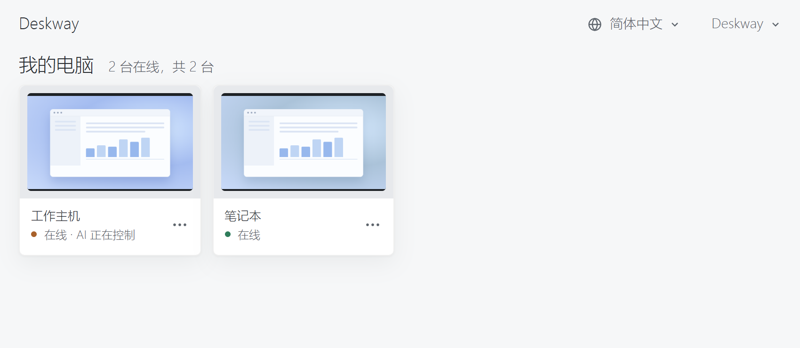
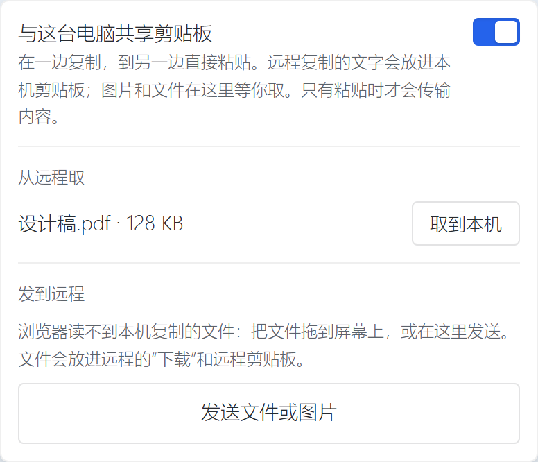

<p align="center"></p>

<h1 align="center">Deskway</h1>

<p align="center"><b>随时随地远程控制你的电脑，也让你的 AI 替你操作它们。</b></p>

<p align="center"><a href="README.md">English</a> · <b>简体中文</b> · <a href="README.zh-Hant.md">繁體中文</a></p>

Deskway 是一套自行部署的远程桌面。你可以在手机、平板或另一台电脑的浏览器里打开自己的 Windows 电脑或 Mac，也可以让 Claude Code 等 AI 助手在你授权的电脑上工作。服务端、账号和中继全部运行在你自己掌控的机器上。

<p align="center"></p>

## Deskway 能做什么

### 浏览器里就能打开你的桌面

手里的设备不需要安装任何软件，打开服务端地址并登录即可。在支持的浏览器上，还可以把 Deskway 作为应用安装到桌面或手机主屏幕。在手机上可以直接触控，也可以切换到触控板模式；输入时使用设备自带的键盘、输入法或语音输入。电脑有多块显示器时，可以在工具栏里切换。

Deskway Host 常驻在 Windows 的系统托盘或 Mac 的菜单栏中。只要电脑开着，即使无人值守，已批准的设备也能随时连接；在 Windows 上，锁屏界面和登录界面同样可以操作。



打开剪贴板共享后，一侧复制的文字可以直接粘贴到另一侧。远程电脑上复制的图片和文件会在剪贴板面板里等待你取回；从本机发送的文件会存入远程电脑的“下载”文件夹，同时放到它的剪贴板上。

<br clear="right">

### AI 原生远控

Deskway 原生支持模型上下文协议（MCP）。在 AI 客户端里添加 `deskway mcp` 后，AI 就能查看屏幕、操作鼠标键盘、运行命令、传输文件、使用电脑上的应用，替你完成这样的任务：

> 把公司工作站上的设计稿.pdf 复制到我的 MacBook 的“下载”文件夹。

> 打开公司工作站上的 AI 绘画工具，生成一张蓝色山景。

> 每天上午 9 点，整理我的 MacBook 上昨天的工作记录。

控制权始终在你手里。AI 客户端要先由你核对六位确认码并批准，才能加入你的账号；之后还要你为某台电脑打开 AI 控制，它才能使用这台电脑。AI 工作时你可以同时打开同一个桌面，比如替它处理一个不该由它确认的对话框，然后让它继续。你可以单独结束 AI 的会话而不影响自己的连接，每台电脑也会记录 AI 调用过的每一个工具及其结果。

### 完全运行在你自己的服务器上

账号、信令、中继和网页端都由你自己的服务端提供，不需要第三方账号，也不经过来路不明的中转服务。网络允许时设备之间直接连接，否则经由服务端内置的 TURN 中继转发；中继只转发加密数据，无法解密画面和输入。会话工具栏会显示当前走的是哪条线路。

### 账号之间互相隔离

一台服务器可以供家人或小团队共用。管理员为每个人创建账号，每个人只能看到和控制自己的电脑。新的浏览器、电脑和 AI 客户端都要在本账号已信任的设备上批准，批准前核对两边显示的确认码是否一致，因此仅凭被盗的密码无法登录。手机丢了，在 **My devices**（我的设备）里一步就能移除。

## Deskway 适合你吗？

如果你想随时随地访问自己的 Windows 或 Mac 电脑，想让 AI 助手在受控的前提下操作真实的桌面，并且能自己维护一台有域名的 Linux 服务器，Deskway 很适合你。

如果你要控制的是 Linux 或 Android 设备，需要临时远程协助别人的电脑，或者完全不想维护服务器，Deskway 就不是合适的选择。

## 与其他工具对比

| | Deskway | RustDesk | Chrome 远程桌面 |
|---|---|---|---|
| AI 通过 MCP 远控 | 原生支持 | 有社区实现 | 不支持 |
| AI 权限控制 | 先批准客户端，再按电脑授权 | 有社区实现 | 不支持 |
| 人与 AI 同时连接 | 人和 AI 各自独立会话，可同时进行 | 有社区实现 | 不支持 |
| AI 操作记录 | 每次工具调用都记录在被控电脑上 | 无 | 无 |
| 信令与中继 | 自己的服务器：直连或自建 TURN 中继 | 可自建 ID 与中继服务器 | 使用 Google 的服务 |
| 网页端 | 由自己的服务器提供 | 符合条件的 Server Pro 方案 | 由 Google 提供 |
| 账号 | 在自己的服务器上管理 | 设备 ID；Pro 支持组织账号和 SSO | Google 账号 |
| 控制端 | 电脑和手机浏览器 | 桌面、移动和网页客户端 | 电脑浏览器、移动应用 |
| 被控端 | Windows、macOS | Windows、macOS、Linux、Android | Windows、macOS、Linux |

以上根据各项目截至 2026 年 11 月的公开文档整理，如有出入欢迎指正。

各项功能和安全模型的详细说明见[概览](docs/overview.md)（英文）。

## 快速开始

1. 在一台有域名和公网 IP 的 Linux 机器上部署服务端，步骤见[自托管部署](docs/self-hosting.md)。
2. 在每台需要远程控制的电脑上安装 Deskway Host，安装包在 [Releases 页面](https://github.com/aerialSpire/deskway/releases)下载。安装说明见 [Windows](docs/install-host-windows.md) 和 [macOS](docs/install-host-macos.md)。
3. 用浏览器打开服务端地址，登录后选择一台电脑。
4. 如需让 AI 客户端使用你的电脑，见 [AI 客户端](docs/ai-clients.md)。

详细文档目前只有英文版。界面支持英文、简体中文和繁体中文，随设备语言切换。文档中的界面名称以英文界面为准，例如 **Members**（成员管理）、**My devices**（我的设备）、**Add an AI client**（添加 AI 客户端）。

## 仓库结构

| 路径 | 内容 |
|---|---|
| `cmd/deskway-server`、`internal/` | Go 服务端：账号、设备批准、WebSocket 信令和 TURN 中继，同时提供网页客户端 |
| `web/static` | 网页客户端（原生 JavaScript），编译时嵌入服务端 |
| `host/` | Deskway Host（Rust），支持 Windows 和 macOS |
| `cli/` | `deskway`，通过 MCP 接入 AI 客户端的命令行程序（Rust） |
| `crates/` | 主机端和 `deskway` 共用的 Rust 库：通信数据类型和 WebRTC 连接 |
| `proto/` | 协议定义、工具列表和测试向量，各端的测试均以此为准 |
| `tests/` | 浏览器端的单元测试、契约测试和端到端测试 |
| `deploy/systemd` | 服务端的 systemd 单元模板 |
| `scripts/` | macOS 应用和 AI 客户端程序的编译脚本，以及本机试用脚本 |

## 从源码编译

需要 Go 1.26 或更高版本和 Rust（stable）。运行测试还需要 Node.js 22 或更高版本。

```sh
# 服务端（任意系统均可编译；网页客户端已嵌入）
go build -o bin/deskway-server ./cmd/deskway-server

# 主机端和 deskway 命令行（在 Windows 或 macOS 上）
cargo build --locked --release -p deskway-host -p deskway

# macOS 应用和 DMG（在 Apple 芯片的 Mac 上）
./scripts/build-mac-host.sh --universal-dmg
```

运行测试：

```sh
go test ./internal/...
cargo test --workspace --locked
node --test tests/unit/*.test.mjs tests/contract/*.test.mjs
```

每个 Pull Request 都会自动运行这些测试。端到端测试用真实浏览器连接运行中的服务端和主机端，说明见 `tests/e2e/run.mjs` 文件开头。如需在一台 Windows 电脑上试用整套系统，请运行 `scripts/try-local.ps1`。

## 发布

桌面端安装包由 **Desktop release** 工作流发布。该工作流需在 **Actions → Desktop release → Run workflow** 中手动启动，并填写标签，例如 `v0.1.0`。发布测试版时，勾选 **Mark the GitHub Release as a prerelease**。每个 Release 包含以下文件：

| 文件 | 内容 |
|---|---|
| `DeskwayHost-Setup-windows-x64.exe` | Windows（x64）版 Deskway Host 安装程序 |
| `DeskwayHost-macos-universal.dmg` | macOS 版 Deskway Host（Apple 芯片和 Intel 通用） |
| `deskway-windows-x64.exe` | Windows 版 AI 客户端程序 |
| `deskway-macos-arm64`、`deskway-macos-x64` | macOS 版 AI 客户端程序 |

AI 客户端程序的文件名与服务端要求的文件名完全一致，自托管的服务端可以直接使用（见[自托管部署第 5 步](docs/self-hosting.md#5-put-the-ai-client-programs-in-place-optional)）。服务端没有预编译版本，请按上文所述从源码编译。

## 文档（英文）

- [概览](docs/overview.md) · [自托管部署](docs/self-hosting.md) · [Windows 主机端安装](docs/install-host-windows.md) · [macOS 主机端安装](docs/install-host-macos.md) · [AI 客户端](docs/ai-clients.md) · [账号](docs/accounts.md)
- 开发者参考：[架构](docs/architecture.md) · [协议](docs/protocol.md) · [安全](docs/security.md) · [会话生命周期](docs/session-lifecycle.md) · [界面设计](docs/design.md) · [翻译](docs/i18n.md)

## 参与贡献与安全

参与贡献的方式见 [CONTRIBUTING.md](CONTRIBUTING.md)。安全漏洞请按 [SECURITY.md](SECURITY.md) 中的说明私下报告，不要提交公开 issue。

## 许可证

Deskway 采用 [GNU Affero 通用公共许可证 v3.0](LICENSE)（AGPL-3.0）。如果你通过网络向他人提供修改版的 Deskway，必须向这些用户提供修改后的源代码。
