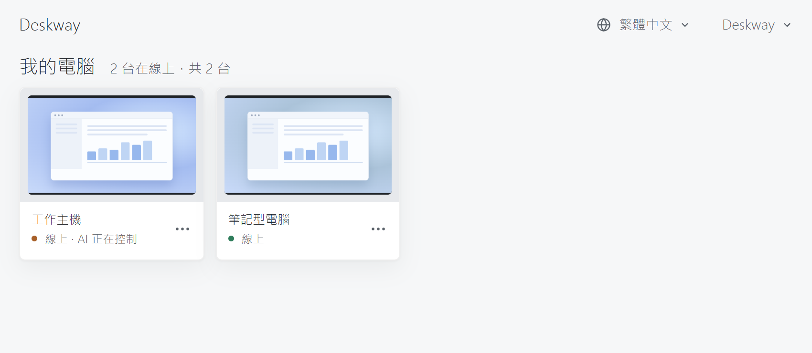
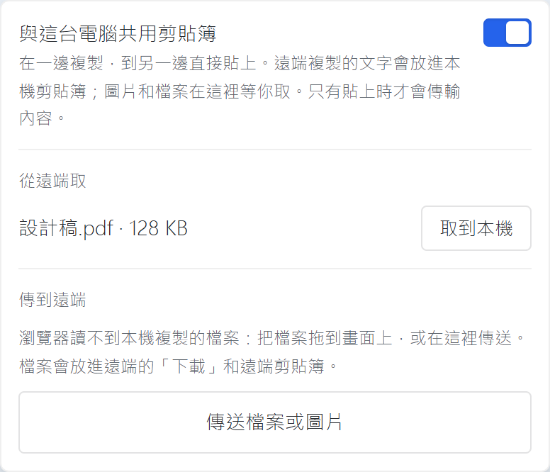

<p align="center"></p>

<h1 align="center">Deskway</h1>

<p align="center"><b>隨時隨地遠端控制你的電腦，也讓你的 AI 替你操作它們。</b></p>

<p align="center"><a href="README.md">English</a> · <a href="README.zh-Hans.md">简体中文</a> · <b>繁體中文</b></p>

Deskway 是一套自行架設的遠端桌面。你可以在手機、平板或另一台電腦的瀏覽器裡開啟自己的 Windows 電腦或 Mac，也可以讓 Claude Code 等 AI 助理在你授權的電腦上工作。伺服器、帳號和中繼全都執行在你自己掌控的機器上。

<p align="center"></p>

## Deskway 能做什麼

### 用瀏覽器就能開啟你的桌面

手上的裝置不需要安裝任何軟體，開啟伺服器位址並登入即可。在支援的瀏覽器上，也能把 Deskway 當成 App 安裝到桌面或手機主畫面。在手機上可以直接觸控，也可以切換成觸控板模式；輸入時使用裝置本身的鍵盤、輸入法或語音輸入。電腦有多個螢幕時，可以在工具列切換。

Deskway Host 常駐在 Windows 的系統匣或 Mac 的選單列。只要電腦開著，即使無人看管，已核准的裝置也能隨時連線；在 Windows 上，鎖定畫面和登入畫面同樣可以操作。



開啟剪貼簿共用後，一端複製的文字可以直接貼到另一端。遠端電腦上複製的圖片和檔案會在剪貼簿面板中等你取回；從本機傳送的檔案會存進遠端電腦的「下載項目」，同時放到它的剪貼簿上。

<br clear="right">

### AI 原生遠端控制

Deskway 原生支援模型上下文協定（MCP）。在 AI 用戶端加入 `deskway mcp` 之後，AI 就能查看螢幕、操作滑鼠鍵盤、執行指令、傳輸檔案、使用電腦上的 App，替你完成這樣的工作：

> 把公司工作站上的設計稿.pdf 複製到我的 MacBook 的「下載項目」。

> 開啟公司工作站上的 AI 繪圖工具，產生一張藍色山景。

> 每天上午 9 點，整理我的 MacBook 上昨天的工作記錄。

控制權始終在你手上。AI 用戶端必須先由你核對六位數確認碼並核准，才能加入你的帳號；之後還要你為某台電腦開啟 AI 控制，它才能使用那台電腦。AI 工作時你可以同時開啟同一個桌面，例如替它處理一個不該由它確認的對話框，再讓它繼續。你可以單獨結束 AI 的工作階段而不影響自己的連線，每台電腦也會記錄 AI 呼叫過的每一個工具及其結果。

### 完全執行在你自己的伺服器上

帳號、訊號、中繼和網頁版都由你自己的伺服器提供，不需要第三方帳號，也不會經過來路不明的中繼服務。網路允許時裝置之間直接連線，否則透過伺服器內建的 TURN 中繼轉送；中繼只轉送加密資料，無法解密畫面和輸入。工作階段工具列會顯示目前使用的是哪條路線。

### 帳號之間彼此隔離

一台伺服器可以讓家人或小團隊共用。管理員為每個人建立帳號，每個人只能看到和控制自己的電腦。新的瀏覽器、電腦和 AI 用戶端都要在本帳號已信任的裝置上核准，核准前會核對兩邊顯示的確認碼是否一致，因此只憑遭竊的密碼無法登入。手機遺失時，在 **My devices**（我的裝置）中一步就能移除。

## Deskway 適合你嗎？

如果你想隨時隨地存取自己的 Windows 或 Mac 電腦，想讓 AI 助理在受控的前提下操作真實的桌面，而且能自行維護一台有網域名稱的 Linux 伺服器，Deskway 很適合你。

如果你要控制的是 Linux 或 Android 裝置，需要臨時遠端協助別人的電腦，或者完全不想維護伺服器，Deskway 就不是合適的選擇。

## 與其他工具比較

| | Deskway | RustDesk | Chrome 遠端桌面 |
|---|---|---|---|
| AI 透過 MCP 遠端控制 | 原生支援 | 有社群專案；官方內建支援仍在 PR 審查中，尚未合併 | 不支援 |
| 訊號與中繼 | 自己的伺服器 | 預設使用官方公用伺服器，也可自架 | 使用 Google 的服務 |
| 網頁版 | 由自己的伺服器提供 | Server Pro 付費方案 | 由 Google 提供 |
| 被控端 | Windows、macOS | Windows、macOS、Linux、Android | Windows、macOS、Linux |

以上截至 2026 年 11 月。[完整比較](docs/comparison.md)（英文）也涵蓋帳號、AI 權限控管和操作記錄，每一項都附有出處。

各項功能和安全模型的詳細說明見[概覽](docs/overview.md)（英文）。

## 快速開始

1. 在一台有網域名稱和公用 IP 的 Linux 機器上架設伺服器，步驟見[自架部署](docs/self-hosting.md)。
2. 在每台需要遠端控制的電腦上安裝 Deskway Host，安裝檔在 [Releases 頁面](https://github.com/aerialSpire/deskway/releases)下載。安裝說明見 [Windows](docs/install-host-windows.md) 和 [macOS](docs/install-host-macos.md)。
3. 用瀏覽器開啟伺服器位址，登入後選擇一台電腦。
4. 如需讓 AI 用戶端使用你的電腦，見 [AI 用戶端](docs/ai-clients.md)。

詳細文件目前只有英文版。介面支援英文、簡體中文和繁體中文，隨裝置語言切換。文件中的介面名稱以英文介面為準，例如 **Members**（成員管理）、**My devices**（我的裝置）、**Add an AI client**（新增 AI 用戶端）。

## 儲存庫結構

| 路徑 | 內容 |
|---|---|
| `cmd/deskway-server`、`internal/` | Go 伺服器：帳號、裝置核准、WebSocket 信令和 TURN 中繼，同時提供網頁用戶端 |
| `web/static` | 網頁用戶端（原生 JavaScript），編譯時嵌入伺服器 |
| `host/` | Deskway Host（Rust），支援 Windows 和 macOS |
| `cli/` | `deskway`，透過 MCP 連接 AI 用戶端的命令列程式（Rust） |
| `crates/` | 主機端和 `deskway` 共用的 Rust 函式庫：通訊資料型別和 WebRTC 連線 |
| `proto/` | 協定定義、工具清單和測試向量，各端的測試均以此為準 |
| `tests/` | 瀏覽器端的單元測試、契約測試和端對端測試 |
| `deploy/systemd` | 伺服器的 systemd 單元範本 |
| `scripts/` | macOS App 和 AI 用戶端程式的編譯腳本，以及本機試用腳本 |

## 從原始碼編譯

需要 Go 1.26 或更新版本和 Rust（stable）。執行測試還需要 Node.js 22 或更新版本。

```sh
# 伺服器（任何系統皆可編譯；網頁用戶端已嵌入）
go build -o bin/deskway-server ./cmd/deskway-server

# 主機端和 deskway 命令列（在 Windows 或 macOS 上）
cargo build --locked --release -p deskway-host -p deskway

# macOS App 和 DMG（在 Apple 晶片的 Mac 上）
./scripts/build-mac-host.sh --universal-dmg
```

執行測試：

```sh
go test ./internal/...
cargo test --workspace --locked
node --test tests/unit/*.test.mjs tests/contract/*.test.mjs
```

每個 Pull Request 都會自動執行這些測試。端對端測試以真實瀏覽器連線到執行中的伺服器和主機端，說明見 `tests/e2e/run.mjs` 檔案開頭。如需在一台 Windows 電腦上試用整套系統，請執行 `scripts/try-local.ps1`。

## 發布

各版本由 **Release** 工作流程發布。此工作流程需在 **Actions → Release → Run workflow** 中手動啟動，並填寫標籤，例如 `v0.1.0`。發布測試版時，勾選 **Mark the GitHub Release as a prerelease**。每個 Release 包含下列檔案：

| 檔案 | 內容 |
|---|---|
| `deskway-server-linux-amd64.tar.gz`、`deskway-server-linux-arm64.tar.gz` | Linux 版伺服器（x86-64 和 ARM64），附授權條款和 systemd 單元範本 |
| `DeskwayHost-Setup-windows-x64.exe` | Windows（x64）版 Deskway Host 安裝程式 |
| `DeskwayHost-macos-universal.dmg` | macOS 版 Deskway Host（Apple 晶片和 Intel 通用） |
| `deskway-windows-x64.exe` | Windows 版 AI 用戶端程式 |
| `deskway-macos-arm64`、`deskway-macos-x64` | macOS 版 AI 用戶端程式 |
| `SHA256SUMS` | 以上檔案的 SHA-256 校驗值 |

伺服器同時以容器映像檔 `ghcr.io/aerialspire/deskway-server` 發布，支援 `linux/amd64` 和 `linux/arm64`，標籤為版本號（例如 `0.1.0`）；正式版（非預先發布版）同時標記為 `latest`。

AI 用戶端程式的檔名與伺服器要求的檔名完全一致，自架的伺服器可以直接使用（見[自架部署第 5 步](docs/self-hosting.md#5-put-the-ai-client-programs-in-place-optional)）。

## 文件（英文）

- [概覽](docs/overview.md) · [自架部署](docs/self-hosting.md) · [Windows 主機端安裝](docs/install-host-windows.md) · [macOS 主機端安裝](docs/install-host-macos.md) · [AI 用戶端](docs/ai-clients.md) · [帳號](docs/accounts.md)
- 開發者參考：[架構](docs/architecture.md) · [協定](docs/protocol.md) · [安全](docs/security.md) · [工作階段生命週期](docs/session-lifecycle.md) · [介面設計](docs/design.md) · [翻譯](docs/i18n.md)

## 參與貢獻與安全

參與貢獻的方式見 [CONTRIBUTING.md](CONTRIBUTING.md)。安全漏洞請依 [SECURITY.md](SECURITY.md) 中的說明私下回報，不要提交公開 issue。

## 授權

Deskway 採用 [GNU Affero 通用公共授權條款 v3.0](LICENSE)（AGPL-3.0）。如果你透過網路向他人提供修改版的 Deskway，必須向這些使用者提供修改後的原始碼。
